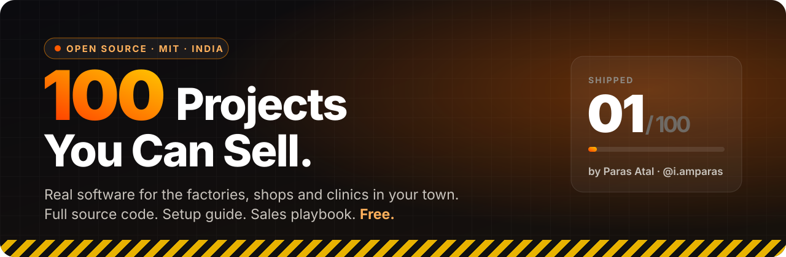
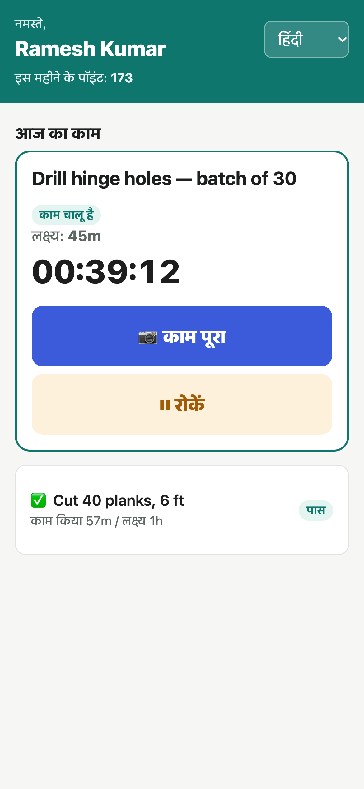
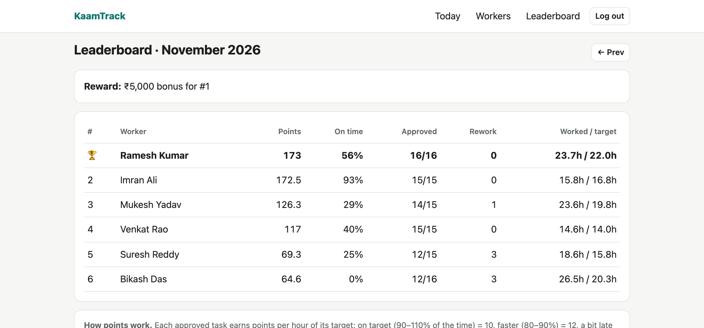

 

### 🔥 100 open-source projects you can sell to businesses in your own town ⚠️

**Full source code · one-command setup · a sales playbook for every project**

 

[**Project 01**](projects/01-kaamtrack) · [**All 100 ideas**](#-the-100) · [**How to sell**](#-how-to-sell-it-to-a-local-business) · [**Request a project**](https://github.com/ParasAtal/100-Projects-You-Can-Sell/issues/new?template=project-request.yml)

 

## ⚠️ Read this first

This is **not** a tutorial repo full of to-do apps.

Every project here solves a problem that a **real business in your town is losing money on today**: a factory that can't track worker hours, a kirana store with udhaar written in a notebook, a clinic with a crowded waiting room.

You get the **code**, the **setup steps**, and **how to pitch it, what to charge, and what to say**.
Fork it, set it up for a business near you, and charge for installation, hosting and support. The MIT licence allows it.

> Built in public by **[Paras Atal](https://www.instagram.com/i.amparas/)**. Every project starts with a real business owner and a real problem, and comes with an Instagram reel showing how it was built.

 

## 🔥 How it works

| Step | | How |
|:--:|:--|:--|
| **1** | **Pick a project** | Choose one from the list below that fits a business you know: a relative's shop, a friend's factory, your local gym. |
| **2** | **Set it up in an hour** | Every project runs with `npm install && npm run demo`. Show the owner a working demo filled with sample data. |
| **3** | **Sell setup + support** | Charge a one-time setup fee and a small monthly fee for hosting and help. Suggested prices are in every row. |

 

## 🚀 Featured · Project 01

### [KaamTrack](projects/01-kaamtrack) — Factory Task Timer

*"Babu, ek ghanta bola tha, do ghante lag gaye."* (I said one hour; it took two.)

A manufacturer in Assam pays skilled workers ₹30–70k a month. The owner says a job takes 1 hour and the worker says it took 2, and nobody has proof. **KaamTrack fixes that.**

- 📋 The owner adds today's tasks with an expected time
- 📸 The worker taps **START** and **FINISH** on their phone, with a photo each time
- ⏸️ Pauses with a reason (machine broke, no material, power cut), so workers aren't blamed unfairly
- ✅ The owner approves quality, and approved work earns points
- 🏆 **Monthly leaderboard** → bonus for the top worker
- 🇮🇳 Hindi + English, and it **works offline**

**Sell to:** factories, workshops, fabrication units, furniture makers
**Charge:** ₹15,000 setup + ₹1,500/month

&nbsp;&nbsp;

<a href="projects/01-kaamtrack"><b>→ Open Project 01: code, setup and demo</b></a>

 

## 💰 The 100

🔥 = live with source code &nbsp;·&nbsp; ⏳ = coming soon &nbsp;·&nbsp; prices are a **suggested starting point** (setup + monthly) and vary by city

### 🏭 Factories & Workshops

| # | Project | Sell to | What it does | Charge |
|:--:|:--|:--|:--|:--|
| 🔥 01 | **[KaamTrack](projects/01-kaamtrack)** | Factories, workshops | Task timer with photo proof, pause reasons, quality check and a monthly points leaderboard | ₹15k + ₹1.5k/mo |
| ⏳ 02 | **Machine Health Log** | Factories | A QR sticker on every machine: scan to log a breakdown, with service-due alerts | ₹10k + ₹1k/mo |
| ⏳ 03 | **Raw Material Alerts** | Small manufacturers | Stock in/out from a phone, with a WhatsApp alert when stock drops below the reorder level | ₹12k + ₹1k/mo |
| ⏳ 04 | **Job Card Board** | Fabrication, printing units | Each order moves cutting → welding → paint → dispatch, and the customer gets a status link | ₹15k + ₹1.5k/mo |
| ⏳ 05 | **Site Attendance** | Labour contractors | Selfie + GPS check-in for workers across multiple sites | ₹10k + ₹1k/mo |
| ⏳ 06 | **Daily Production Report** | Line supervisors | Output and rejects entered in 1 minute, with a 7 pm summary to the owner | ₹10k + ₹1k/mo |
| ⏳ 07 | **Rejection Tracker** | Quality teams | Defect photos by type, plus a chart of the top 5 reasons for rejected work | ₹12k + ₹1k/mo |
| ⏳ 08 | **Gate Pass & Truck Log** | Factory security | Vehicles and visitors in/out with photo and time, and no lost registers | ₹8k + ₹800/mo |
| ⏳ 09 | **Scrap Sale Ledger** | Metal & wood units | Records scrap weight, rate and buyer, so scrap money stops disappearing | ₹6k + ₹500/mo |
| ⏳ 10 | **Piece-Rate Wages** | Garment & packing units | Wages calculated from daily output, with advances deducted automatically | ₹12k + ₹1k/mo |

### 🛒 Shops & Retail

| # | Project | Sell to | What it does | Charge |
|:--:|:--|:--|:--|:--|
| ⏳ 11 | **Digital Udhaar Khata** | Kirana, hardware stores | Credit book with polite WhatsApp payment reminders | ₹5k + ₹500/mo |
| ⏳ 12 | **Expiry Alert** | Pharmacies, kirana | Warns 30 days before stock expires, so less gets thrown away | ₹6k + ₹500/mo |
| ⏳ 13 | **WhatsApp Order Page** | Any local shop | Catalogue + cart → order lands in WhatsApp, with no app store fees | ₹8k + ₹500/mo |
| ⏳ 14 | **Loyalty by Phone No.** | Cafés, sweet shops | Points against the customer's phone number, with no cards to carry | ₹6k + ₹500/mo |
| ⏳ 15 | **Daily Cash Closing** | Any counter business | Cash + UPI + card reconciliation and a shortage alert | ₹6k + ₹500/mo |
| ⏳ 16 | **Price Finder** | Hardware, auto parts | Search 5,000 items in a second, so new staff don't guess prices | ₹8k + ₹500/mo |
| ⏳ 17 | **Repair Job Tracker** | Mobile & laptop repair | Device intake with photos and an SMS status link for the customer | ₹8k + ₹800/mo |
| ⏳ 18 | **Tailor Order Book** | Tailors, boutiques | Measurements saved per customer, with delivery dates and reminders | ₹6k + ₹500/mo |
| ⏳ 19 | **Supplier Reorder List** | Kirana, supermarts | Tap low items → a ready purchase order for each supplier | ₹6k + ₹500/mo |
| ⏳ 20 | **Offer Poster + QR** | Any shop | Make a festive offer page and a printable QR poster in 2 minutes | ₹4k + ₹300/mo |

### 🍽️ Restaurants & Food

| # | Project | Sell to | What it does | Charge |
|:--:|:--|:--|:--|:--|
| ⏳ 21 | **QR Table Menu** | Restaurants, cafés | Scan → menu → order to the kitchen, with no aggregator commission | ₹10k + ₹1k/mo |
| ⏳ 22 | **Kitchen Order Screen** | Cloud kitchens | Live order board with prep timers and a late-order alert | ₹10k + ₹1k/mo |
| ⏳ 23 | **Tiffin Subscription** | Tiffin & mess services | Meal skips, monthly bills and delivery lists | ₹8k + ₹800/mo |
| ⏳ 24 | **Wastage Log** | Restaurants | Logs daily wastage by item, showing where the money is leaking | ₹8k + ₹800/mo |
| ⏳ 25 | **Staff Roster** | Restaurants, hotels | Weekly shifts, leave requests and swaps on WhatsApp | ₹6k + ₹500/mo |
| ⏳ 26 | **Review Booster** | Any food business | Happy customer → Google review; unhappy → private feedback | ₹5k + ₹500/mo |
| ⏳ 27 | **Festival Pre-Order** | Sweet shops, bakeries | Diwali/Eid/Rakhi pre-orders with pickup slots | ₹6k + ₹500/mo |
| ⏳ 28 | **Custom Cake Orders** | Bakeries | Design photo, message, flavour and a delivery calendar | ₹6k + ₹500/mo |
| ⏳ 29 | **Catering Bookings** | Caterers, dhabas | Event calendar, menu per plate, advance payments | ₹8k + ₹800/mo |
| ⏳ 30 | **Supplier Ledger** | Restaurants | Daily milk/vegetable/meat entries and a monthly settlement | ₹5k + ₹500/mo |

### 🏥 Clinics & Health

| # | Project | Sell to | What it does | Charge |
|:--:|:--|:--|:--|:--|
| ⏳ 31 | **Live Token Queue** | Clinics | Patients see their token number on their phone and wait outside, not in the clinic | ₹8k + ₹800/mo |
| ⏳ 32 | **Appointment Reminders** | Doctors, dentists | Booking page + WhatsApp reminder, so fewer patients miss appointments | ₹8k + ₹800/mo |
| ⏳ 33 | **Prescription Printer** | Small clinics | Visit notes + clean printed prescriptions with the patient's history | ₹10k + ₹1k/mo |
| ⏳ 34 | **Refill Reminders** | Pharmacies | Monthly reminder to patients on regular medicines, so they come back to the same pharmacy | ₹6k + ₹500/mo |
| ⏳ 35 | **Lab Report Delivery** | Diagnostic labs | Reports delivered by private link, so patients don't have to come back | ₹10k + ₹1k/mo |
| ⏳ 36 | **Treatment Plan Tracker** | Physio, dental | Sessions done vs planned, with payment balance | ₹8k + ₹800/mo |
| ⏳ 37 | **Vaccination Reminders** | Child clinics | Vaccine schedule per child with reminders to parents | ₹6k + ₹500/mo |
| ⏳ 38 | **Optical Order Tracker** | Optical shops | Prescription + frame + lens order status | ₹6k + ₹500/mo |
| ⏳ 39 | **Bed Board** | Nursing homes | Live bed status, admissions and running bill | ₹15k + ₹1.5k/mo |
| ⏳ 40 | **Doctor On-Call Roster** | Hospitals | Who's on duty now, one tap to call | ₹8k + ₹800/mo |

### 🎓 Coaching & Schools

| # | Project | Sell to | What it does | Charge |
|:--:|:--|:--|:--|:--|
| ⏳ 41 | **Fee Tracker** | Coaching, tuition | Fees due, part-payments and automatic reminders to parents | ₹8k + ₹800/mo |
| ⏳ 42 | **QR Attendance** | Coaching centres | Student scans a QR and the parent gets an "arrived" message | ₹8k + ₹800/mo |
| ⏳ 43 | **Report Card Maker** | Schools, coaching | Test marks → printable progress reports with charts | ₹8k + ₹800/mo |
| ⏳ 44 | **Doubt Board** | Coaching centres | Students post a photo of their doubt and the teacher replies | ₹10k + ₹1k/mo |
| ⏳ 45 | **School Bus Tracker** | Schools, van owners | Driver's phone = GPS, so parents see where the bus is | ₹15k + ₹1.5k/mo |
| ⏳ 46 | **Library Manager** | Schools, libraries | Issue/return, overdue fines, book search | ₹6k + ₹500/mo |
| ⏳ 47 | **Mock Test Platform** | Local coaching | Timed online tests, auto-checked, with a rank list | ₹15k + ₹1.5k/mo |
| ⏳ 48 | **Homework Diary** | Schools | Daily homework sent to parents, with no lost diaries | ₹8k + ₹800/mo |
| ⏳ 49 | **Admission CRM** | Schools, coaching | Enquiries → follow-up reminders → admissions | ₹10k + ₹1k/mo |
| ⏳ 50 | **Certificate + QR Verify** | Institutes | Generate certificates that anyone can verify with a scan | ₹6k + ₹500/mo |

### 💇 Salons, Gyms & Studios

| # | Project | Sell to | What it does | Charge |
|:--:|:--|:--|:--|:--|
| ⏳ 51 | **Salon Booking + Commission** | Salons | Slot booking and per-staff commission calculation | ₹8k + ₹800/mo |
| ⏳ 52 | **Gym Renewals** | Gyms | Membership expiry alerts, so members don't quietly stop paying | ₹8k + ₹800/mo |
| ⏳ 53 | **Workout Cards** | Gyms, trainers | A personal plan per member on their phone | ₹6k + ₹500/mo |
| ⏳ 54 | **Batch Manager** | Yoga, dance, music classes | Batches, attendance and monthly fees | ₹6k + ₹500/mo |
| ⏳ 55 | **Studio Booking + Album** | Photographers | Shoot booking and private photo-album delivery | ₹10k + ₹1k/mo |
| ⏳ 56 | **Prepaid Sessions Wallet** | Spas, salons | Sell packages and track sessions used | ₹6k + ₹500/mo |
| ⏳ 57 | **Laundry Tags** | Laundry, dry cleaners | Tag number → status → "ready" message | ₹6k + ₹500/mo |
| ⏳ 58 | **Service History** | Car wash, detailing | Every vehicle's past services and the next due date | ₹6k + ₹500/mo |
| ⏳ 59 | **Bike Service Job Card** | Two-wheeler garages | Complaint, parts, labour, bill and a reminder for the next service | ₹8k + ₹800/mo |
| ⏳ 60 | **Pet Care Records** | Pet groomers, vets | Bookings and vaccination history per pet | ₹6k + ₹500/mo |

### 🏠 Rentals, Property & Societies

| # | Project | Sell to | What it does | Charge |
|:--:|:--|:--|:--|:--|
| ⏳ 61 | **PG Rent Manager** | PGs, hostels | Rooms, beds, rent due and deposit tracking | ₹8k + ₹800/mo |
| ⏳ 62 | **Landlord Ledger** | Landlords | Rent, bills and agreements for every tenant in one place | ₹5k + ₹500/mo |
| ⏳ 63 | **Society Dues + Complaints** | Housing societies | Maintenance collection and complaint tickets | ₹10k + ₹1k/mo |
| ⏳ 64 | **Broker Listings Site** | Property brokers | Own listing website with lead capture, no portal fees | ₹12k + ₹1k/mo |
| ⏳ 65 | **Visitor Entry** | Societies, offices | Guard logs visitors and the resident approves on their phone | ₹10k + ₹1k/mo |
| ⏳ 66 | **Site Progress Report** | Builders, contractors | Daily photos + work done + material used per site | ₹12k + ₹1k/mo |
| ⏳ 67 | **Quotation Builder** | Interior designers | Itemised, branded quotations in minutes | ₹8k + ₹800/mo |
| ⏳ 68 | **Rental Inventory** | Furniture, appliance rental | Who has what, return dates and deposits | ₹8k + ₹800/mo |
| ⏳ 69 | **Shop Rent Collection** | Market complexes | Rent from many shop owners, with receipts | ₹8k + ₹800/mo |
| ⏳ 70 | **Vendor Schedule** | Societies | Water tanker, cleaning and security vendor visits and payments | ₹6k + ₹500/mo |

### 🚚 Delivery, Transport & Field Work

| # | Project | Sell to | What it does | Charge |
|:--:|:--|:--|:--|:--|
| ⏳ 71 | **Proof of Delivery** | Distributors | Photo + signature on delivery, so "never received" disputes end | ₹10k + ₹1k/mo |
| ⏳ 72 | **Trip & Diesel Ledger** | Transporters | Trips, diesel, toll and driver advances per truck | ₹10k + ₹1k/mo |
| ⏳ 73 | **Field Sales Tracker** | FMCG distributors | GPS check-in at each shop visit, with orders taken | ₹12k + ₹1k/mo |
| ⏳ 74 | **AMC Service App** | AC, RO, CCTV dealers | Technician jobs and annual-contract renewal reminders | ₹10k + ₹1k/mo |
| ⏳ 75 | **Parcel Counter** | Courier franchises | Booking, rates, tracking numbers and daily cash | ₹8k + ₹800/mo |
| ⏳ 76 | **Water Can Subscription** | Water suppliers | Daily cans, empty-can returns and monthly bills | ₹6k + ₹500/mo |
| ⏳ 77 | **Cylinder Booking** | Gas agencies | Booking and a delivery route list for the day | ₹8k + ₹800/mo |
| ⏳ 78 | **Fleet Collection** | Auto/e-rickshaw owners | Daily collection from each driver, with pending dues | ₹6k + ₹500/mo |
| ⏳ 79 | **Rack Locator** | Warehouses | Find any item's rack in a second | ₹10k + ₹1k/mo |
| ⏳ 80 | **Driver Duty Hours** | Fleet owners | Duty start/stop and overtime | ₹6k + ₹500/mo |

### 🌾 Farms, Dairy & Rural

| # | Project | Sell to | What it does | Charge |
|:--:|:--|:--|:--|:--|
| ⏳ 81 | **Milk Collection** | Dairy centres | Fat/SNF rate, daily litres and farmer payment slips | ₹10k + ₹1k/mo |
| ⏳ 82 | **Mandi Ledger** | Commission agents | Farmer lots, buyers, commission and payments | ₹10k + ₹1k/mo |
| ⏳ 83 | **Cold Storage Lots** | Cold storages | Lot in/out, rent per bag and owner statements | ₹12k + ₹1k/mo |
| ⏳ 84 | **Poultry Batch Tracker** | Poultry farms | Feed, deaths and weight per batch, and profit per batch | ₹8k + ₹800/mo |
| ⏳ 85 | **Tractor Booking** | Equipment renters | Booking calendar, hours used and payments | ₹6k + ₹500/mo |
| ⏳ 86 | **Nursery Inventory** | Plant nurseries | Plants in stock, orders, delivery | ₹6k + ₹500/mo |
| ⏳ 87 | **Pond Log** | Fish farmers | Feeding, water quality, harvest per pond | ₹6k + ₹500/mo |
| ⏳ 88 | **Veggie Box Subscription** | Organic farms | Weekly box subscriptions and delivery list | ₹8k + ₹800/mo |
| ⏳ 89 | **Seed & Fertiliser Credit** | Agri input shops | Credit per farmer, due at harvest time | ₹6k + ₹500/mo |
| ⏳ 90 | **Plucking Weight & Wages** | Tea gardens | Daily leaf weight per worker → automatic wages | ₹12k + ₹1k/mo |

### 🎉 Events, Temples & Local Services

| # | Project | Sell to | What it does | Charge |
|:--:|:--|:--|:--|:--|
| ⏳ 91 | **Wedding Planner Board** | Event planners | Checklist, vendors, payments and a day-of timeline | ₹10k + ₹1k/mo |
| ⏳ 92 | **Tent House Rentals** | Tent & decor houses | Items out, items back, damages, bill | ₹8k + ₹800/mo |
| ⏳ 93 | **Temple Donations** | Temples, trusts | Donation receipts and puja slot booking | ₹8k + ₹800/mo |
| ⏳ 94 | **Turf Slot Booking** | Turfs, courts | Hourly slots, online advance, no double booking | ₹8k + ₹800/mo |
| ⏳ 95 | **Tournament Manager** | Local leagues | Fixtures, live scores and a points table | ₹6k + ₹500/mo |
| ⏳ 96 | **Banquet Calendar** | Banquet halls | Dates, packages and advance tracking | ₹8k + ₹800/mo |
| ⏳ 97 | **Tour Manifest** | Travel agents | Packages, passenger lists and payments | ₹8k + ₹800/mo |
| ⏳ 98 | **Driving School** | Driving schools | Lesson slots, progress and licence test dates | ₹6k + ₹500/mo |
| ⏳ 99 | **NGO Volunteer Hub** | NGOs, clubs | Volunteers, events and donation receipts | ₹6k + ₹500/mo |
| ⏳ 100 | **Market Directory** | Market associations | "Shops near me" site for a local market, with every shop listed | ₹10k + ₹1k/mo |

 

## 🧰 How to sell it to a local business

1. **Find the pain.** Don't pitch "software". Ask: *"Where do you lose money or time every week?"*
2. **Show, don't explain.** Run `npm run demo` and hand them your phone. A working screen with their kind of data sells better than any slides.
3. **Price on what they save.** If KaamTrack saves 10% of the time across 8 workers at ₹40k each, that's ~₹32,000 a month back. ₹1,500/month is easy to say yes to.
4. **Run a 2-week free trial.** Set it up, train one person, then come back with their own numbers.
5. **Charge for setup + monthly.** Setup covers installation and training. Monthly covers hosting, backups and help on WhatsApp.
6. **Ask for a referral.** Factory owners know other factory owners.

 

## 🙋 FAQ

<b>Can I really sell this?</b>

 
Yes. Everything is MIT-licensed. You can use, modify and charge for it. Keep the licence file. Credit is appreciated, not required.

<b>Do I need to be a pro developer?</b>

 
No. If you can install Node.js and follow a README, you can run every project. Changing features needs basic JavaScript, and that's a great way to learn.

<b>Where do I host it for a client?</b>

 
Each project's README has deploy steps. Usually that's a ₹300–500/month VPS, or Railway/Render. Many owners are also fine with a PC in their office.

<b>How often do new projects drop?</b>

 
Follow <a href="https://www.instagram.com/i.amparas/">@i.amparas</a> on Instagram. Each project launches with a reel, and the code lands here the same day. ⭐ Star and 👁️ Watch this repo to get notified.

<b>I have a business problem. Can you build for it?</b>

 
<a href="https://github.com/ParasAtal/100-Projects-You-Can-Sell/issues/new?template=project-request.yml">Request a project</a>. The best real-world requests jump the queue.

 

## 🤝 Contribute

- 🌐 **Translations.** Telugu, Assamese, Bengali, Tamil, Marathi… so workers can use the app in their own language.
- 🐛 **Bug fixes** and **deploy guides** for new hosts.
- 💡 **Real stories.** Sold one of these? Open an issue and tell us. Your story may be featured.

 

### If this repo helps you earn your first ₹10,000, ⭐ star it.

**Made in India 🇮🇳 by [Paras Atal](https://www.instagram.com/i.amparas/)**

[Instagram](https://www.instagram.com/i.amparas/) · [GitHub](https://github.com/ParasAtal)

