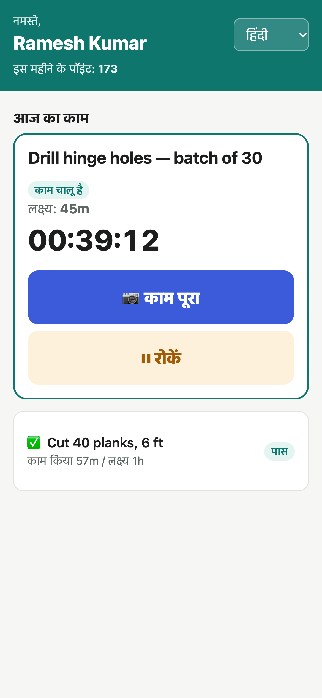
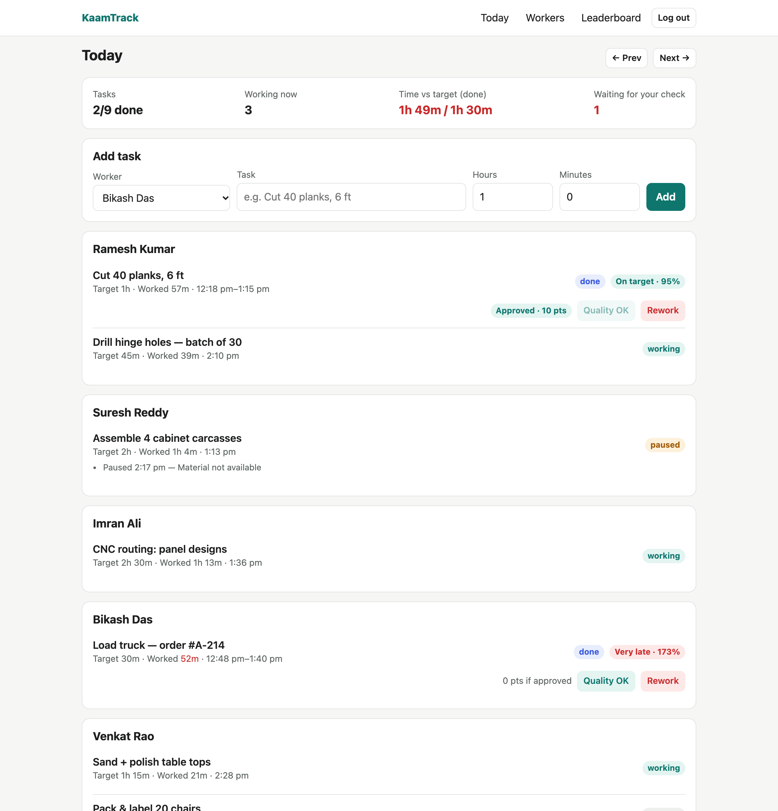

<div align="center">

<sub>[← 100 Projects You Can Sell](../../README.md) · Project 01 / 100</sub>

# 🏭 KaamTrack

**Free, open-source task timer for factories and workshops.**
Photo proof · pause reasons · quality check · monthly leaderboard · Hindi + English · works offline

**Sell to:** factories, workshops, fabrication & furniture units &nbsp;·&nbsp; **Charge:** ₹15,000 setup + ₹1,500/month

<br>

&nbsp;&nbsp;

<sub>What the worker sees: open a link, tap START, take a photo. No app, no password.</sub>

<br><br>



<sub>What the owner sees: who's working on what, time vs target, pauses with reasons, quality check.</sub>

</div>

---

The owner says a job takes 1 hour. The worker says it took 2. Nobody has proof.
KaamTrack fixes that:

1. **Owner** adds today's tasks: who, what, expected time.
2. **Worker** opens a private link on their phone (no app, no password), taps **START** and takes a photo of the work, taps **FINISH** and takes another photo.
3. Breakdowns, power cuts and missing material are logged with **Pause + reason**, so the worker isn't blamed for them.
4. Owner checks quality (**OK / Rework**). Approved tasks earn points.
5. **Monthly leaderboard** → reward the top worker.

After a month you also learn the *real* time each job takes, so your targets become fair.

Works in Hindi and English, works with bad network (taps are saved on the phone and sent later), and runs on a cheap server or even a PC in the factory office.

## Points

Points per hour of target, only for tasks the owner approves:

| Time taken vs target | Points / hour |
|---|---|
| under 80% | 12 — **flagged** for owner to check (target too loose, or rushed) |
| 80–90% | 12 |
| 90–110% | 10 (on target) |
| 110–130% | 6 |
| 130–160% | 3 |
| over 160% | 0 |

Pause time doesn't count. Rework = 0. Change the rules in `lib/scoring.ts`.

## Run it on your laptop

Needs [Node.js 20+](https://nodejs.org).

```bash
git clone https://github.com/ParasAtal/100-Projects-You-Can-Sell.git
cd 100-Projects-You-Can-Sell/projects/01-kaamtrack
npm install
cp .env.example .env.local     # then edit OWNER_PIN and SESSION_SECRET
```

**See it full of sample data first.** This is a month of a 6-worker factory, perfect for demoing to a client:

```bash
npm run demo        # creates data/demo.db (your real data is untouched)
npm run dev:demo    # open http://localhost:3000, PIN from .env.local
```

**Start fresh for a real factory:**

```bash
npm run dev
```

Open http://localhost:3000 → log in with your PIN → **Workers** → add workers → send each one their link on WhatsApp → add tasks on **Today**.

To try the worker screen on your own phone, both must be on the same Wi-Fi: run `npm run dev -- -H 0.0.0.0` and open `http://<your-laptop-ip>:3000/w/<token>`. The camera needs HTTPS on real phones, so for a real factory deploy it (below).

## Deploy for a factory

### Free: Vercel + Turso + Vercel Blob (no server to manage, about 15 minutes)

1. **Fork this repo** on GitHub.
2. On [vercel.com](https://vercel.com), sign in with GitHub → **Add New → Project** → import your fork.
   Set **Root Directory** to `projects/01-kaamtrack` and click **Create Project**. Don't deploy yet.
   (`vercel.json` runs the server in Mumbai, next to the database. Change `bom1` if you're elsewhere.)
3. In the project, open **Storage**:
   - **Create Storage → Turso** (free Starter plan, region Mumbai), then **Connect** it to the project. Any env prefix works; the app finds `*_TURSO_DATABASE_URL` itself.
   - **Create Storage → Blob**: region Mumbai, access **Private**, and tick **"Add a read-write token env var"**.
4. **Settings → Environment Variables**, add:
   - `OWNER_PIN`: 6+ digits, the factory owner's login
   - `SESSION_SECRET`: a long random string (`node -e "console.log(require('crypto').randomBytes(32).toString('hex'))"`)
   - `APP_TIMEZONE`: `Asia/Kolkata`
   - `MONTHLY_REWARD`: optional, e.g. `₹5,000 bonus for #1`
5. **Deploy** (or Deployments → Redeploy). Open the URL, log in, add workers and send them their links.

### Or any server that keeps files on disk

- **A ₹300–500/month VPS** (Hostinger, DigitalOcean, Hetzner): `npm run build && npm start` behind Caddy for free HTTPS.
- **Railway / Render** with a persistent volume mounted at `data/`.

The app refuses to start in production without `OWNER_PIN` and `SESSION_SECRET`.

## Selling it

MIT licence: you can install it for businesses near you and charge for setup, hosting and support. A common model is a one-time setup fee plus a small monthly fee for hosting and help.

## Privacy

Photos are of the **work**, not the worker. Tell workers what is recorded and why (India's DPDP Act requires notice). Photos are visible only to the logged-in owner.

## Code map

| | |
|---|---|
| `app/(owner)/` | Owner pages: Today, Workers, Leaderboard |
| `app/w/[token]/` | Worker phone screen (offline queue, camera, timer) |
| `app/api/w/[token]/action` | Start / pause / resume / finish endpoint |
| `lib/engine.ts` | Task state machine and time calculation |
| `lib/scoring.ts` | Points rules |
| `lib/i18n.ts` | Worker-screen text — add your language here |
| `scripts/seed-demo.mjs` | Fills a demo database with a month of sample data |

## Contributing

Translations (Telugu, Assamese, Bengali, Tamil, Marathi…) are the most useful contribution. Please have a native speaker check them.

MIT © Paras Atal
